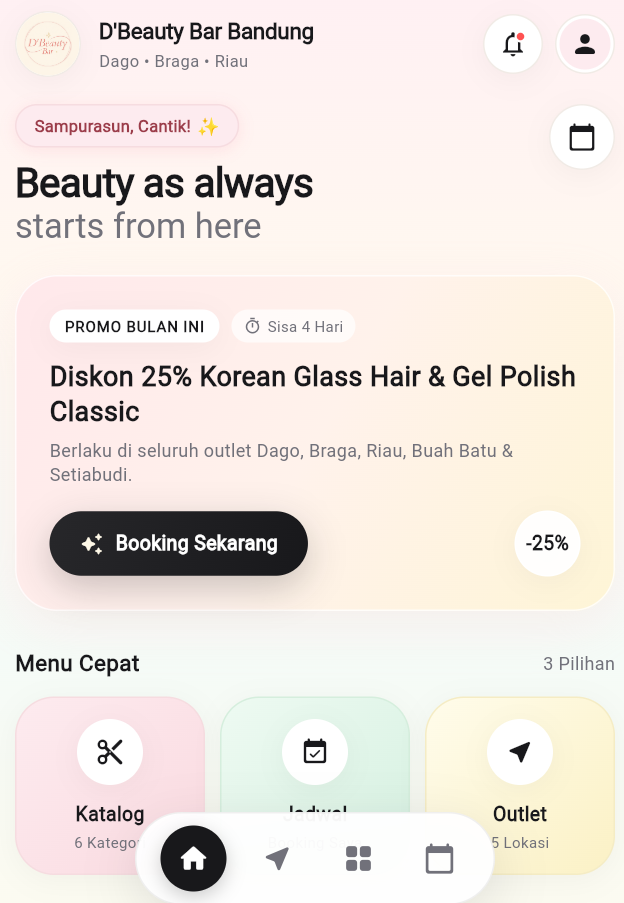
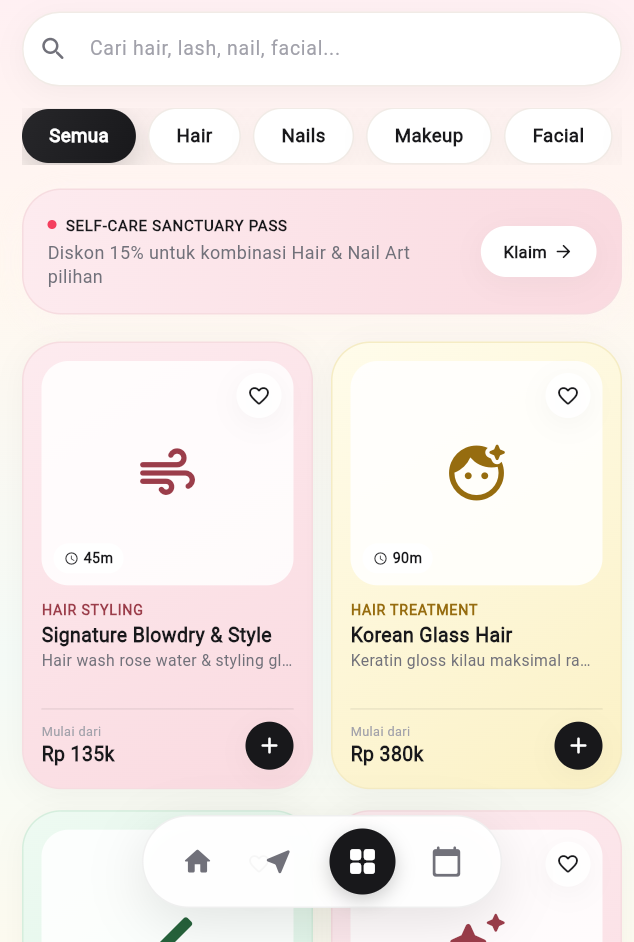
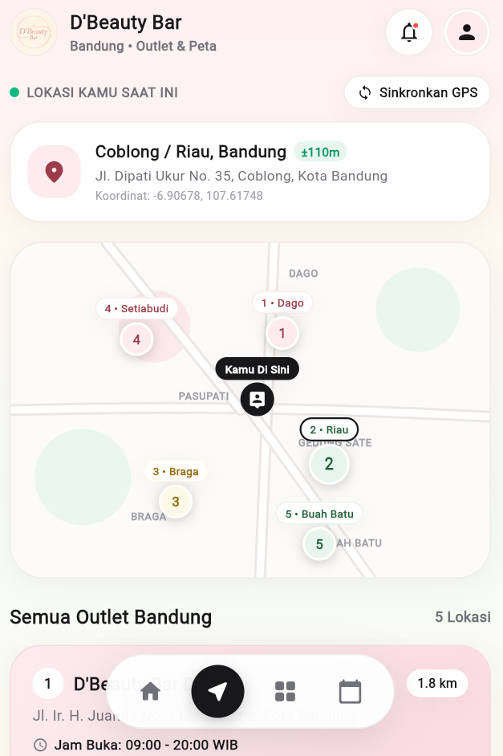

# 💅 D-Beauty Bar Apps

Aplikasi mobile modern untuk layanan reservasi dan katalog perawatan kecantikan (*beauty bar*). Dibangun menggunakan **Flutter** untuk memberikan pengalaman pemesanan layanan kecantikan yang cepat, praktis, dan estetis.

---

## Fitur Utama

- **Katalog Layanan Kecantikan:** Jelajahi berbagai kategori perawatan (seperti *Nail Art*, *Eyelash Extension*, *Facial*, *Hair Treatment*, dll.) lengkap dengan harga dan durasi pengerjaan.
- **Reservasi Jadwal (*Booking*):** Pilih layanan, tanggal, dan jam kedatangan secara langsung melalui aplikasi.
- **Detail & Paket Promo:** Informasi lengkap mengenai deskripsi perawatan serta penawaran paket spesial.
- **Profil & Riwayat Pemesanan:** Pantau status jadwal perawatan yang sedang berjalan maupun riwayat transaksi sebelumnya.
- **Antarmuka Responsif & Estetis:** Desain UI yang bersih, nyaman digunakan, dan disesuaikan untuk perangkat Android maupun iOS.

---

## Teknologi yang Digunakan

- **Framework:** [Flutter](https://flutter.dev/)
- **Bahasa Pemrograman:** [Dart](https://dart.dev/)
- **State Management:** [Sesuaikan, misal: Provider / GetX / Bloc / setState]
- **Backend / Database:** [Sesuaikan, misal: Firebase / REST API / Local Storage]

---

## *Screenshots*

| Halaman Utama | Katalog Layanan | Lokasi |
| :---: | :---: | :---: |
|  |  |  |

---

## Cara Menjalankan Proyek secara Lokal

Pastikan kamu sudah menginstal **Flutter SDK** di komputermu sebelum menjalankan proyek ini.

1. **Clone repositori ini**
   ```bash
   git clone [https://github.com/divasephira20/D-Beauty-Bar-Apps.git](https://github.com/divasephira20/D-Beauty-Bar-Apps.git)
